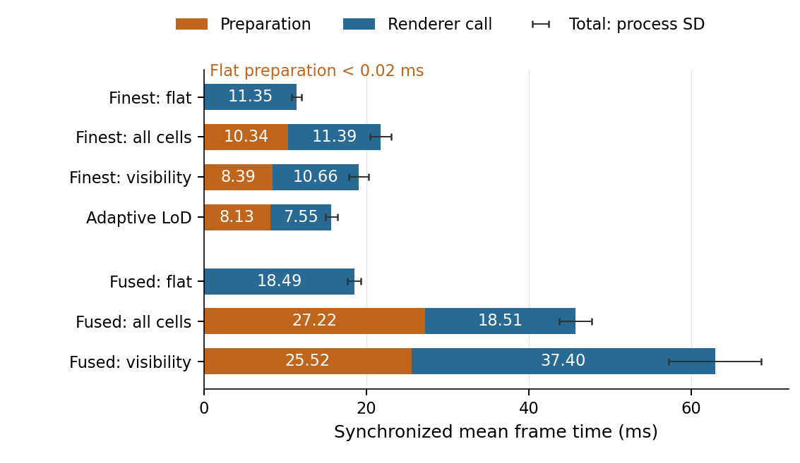

# Beyond Gaussian Count

**Runtime Analysis and Materialization-Aware Execution in Large-Scale 3D Gaussian Splatting**

Reader companion to Luis Ribeiro's Master's dissertation. This view contains
the runtime implementation, focused correctness tests, thirteen key result
records, and commands to verify the numerical analyses.

## Research question and findings

How well does Gaussian count explain the cost of rendering a large scene?
This work examines where time and memory go between scene selection and
rasterization, using CityGaussian and ALoD reproductions and the project-specific
ALoD-Ext materialization and residency extension.

- **Selection has a cost.** In the CityGaussian controlled ladder, reducing
  selected Gaussians does not consistently reduce total frame time. Selection,
  assembly and renderer behavior must be measured together. See the
  [timing](results/citygaussian/controlled_ladder.json) and
  [population](results/citygaussian/gaussian_counts.json) records.
- **Selected and materialized populations differ.** ALoD-Ext filters rows
  after semantic selection, before gathering and transferring Gaussian
  properties. Semantic selection stays unchanged, and retained rows preserve
  their order and duplicate occurrences. See the
  [MatrixCity comparison](results/alod_exec/matrixcity_formal.json) and
  [ordered-multiset control](results/alod_exec/synthetic_multiset.json).
- **Reuse policy depends on the workload.** The bounded cache is faster than
  previous-working-set reuse on both final natural trajectories; the synthetic
  control exhibits a different policy ordering. See the
  [natural-workload comparison](results/alod_exec/natural_completion.json).



CityGaussian controlled ladder using the project's gsplat renderer. Bars show
preparation plus renderer-call time; whiskers show the standard deviation
between fresh processes. The figure is regenerated from pinned numerical
evidence by the command below. These are project measurements within this
protocol, not a ranking of the original papers.

The independent CityGaussian reproduction covers runtime cell organization,
released visibility and adaptive LoD, with source-derived oracle checks. The
ALoD reproduction covers hierarchy decoding, HSPT, camera-dependent selection
and source-faithful evaluation, including an instrumented topology correction.
ALoD-Ext adds filtering before materialization and GPU residency policies;
it is a project contribution separate from those reproduced algorithms.
Historical `ALOD-EXT-*` experiment identifiers and paths under `alod_exec/`
retain their original names.

## Read the results

Start with [results/README.md](results/README.md). It maps the thesis topics to
the relevant records and code. The JSON result files are unchanged copies of
the original campaign tables; their source identities are in
[companion.json](companion.json).

```bash
python tools/verify_release.py
python tools/verify_natural_results.py
```

These commands need Python and Git, with no GPU or downloaded scene.

## Reproduce the analyses

```bash
python -m pip install -r requirements-evidence.txt
python reproduction/figures/generate_final_empirical_figures.py --output local/figures
```

This regenerates five empirical figures and the PNG preview above from the
saved numerical records.
[REPRODUCING.md](docs/REPRODUCING.md) covers installation, focused tests,
synthetic GPU rendering, an [ALoD-Ext example](docs/REPRODUCING.md#alod-ext-example),
and external inputs for real-scene experiments. Read the
[metric glossary](docs/METRICS.md) before interpreting counts, FPS or memory.

## Detailed evidence

The [complete audited record at v1.0.0](https://github.com/LuisRibeiro2903/beyond_gaussian_count/tree/v1.0.0)
preserves the full numerical traces, protocols, validation reports, historical
source snapshots, auxiliary tools and development documentation. The analysis
commands read those records from the pinned Git revision without expanding
thousands of files into this working tree. Standard Git clones include it.

For a shallow clone, fetch it once with `git fetch origin tag v1.0.0`.
For a ZIP download, also obtain the [full-record ZIP](https://github.com/LuisRibeiro2903/beyond_gaussian_count/archive/refs/tags/v1.0.0.zip)
and set `BEYOND_EVIDENCE_DIR` to its extracted root. The expected revision is
`42af4e9ec5fb9bb4c75ef3229b6bbb517fb28a6c`.

## Scope and reuse

CityGaussian and ALoD algorithms belong to their original authors. This work
provides reproduction, instrumentation, controlled evaluation and the explicitly
identified ALoD-Ext extension. Results are compared within their stated
protocols, not used as a cross-method ranking or a reproduction of paper FPS.

Images, scene models, trained hierarchies and restricted raw camera payloads
must be obtained separately. Negative findings remain visible in the result
guide. Five older natural-association source versions were not recovered;
their exact historical replay is not claimed. The final natural campaign's
sealed files and recovered canonical CityGaussian sources are documented in
the full record. Numerical evidence can still be inspected and checked.

Original contributions use MIT. Upstream-derived portions retain their
noncommercial/research, share-alike or Apache terms; see [LICENSE.md](LICENSE.md)
and [NOTICE](NOTICE). Dataset and asset acquisition restrictions are documented
in [EXTERNAL_INPUTS.md](docs/EXTERNAL_INPUTS.md).

## Citation

Citation metadata are in [CITATION.cff](CITATION.cff). For this reader companion,
cite Luis Ribeiro, *Beyond Gaussian Count: thesis code and experimental
evidence*, version **1.1.2** (29 October 2026),
[`LuisRibeiro2903/beyond_gaussian_count`](https://github.com/LuisRibeiro2903/beyond_gaussian_count)
at tag `v1.1.2`. The complete historical evidence is separately identified by
`v1.0.0`, commit `42af4e9ec5fb9bb4c75ef3229b6bbb517fb28a6c`.
Cite the original CityGaussian and ALoD publications when using their methods.
No DOI is assigned.
