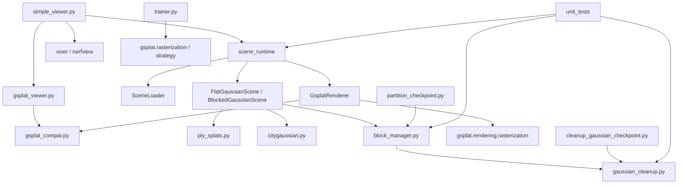
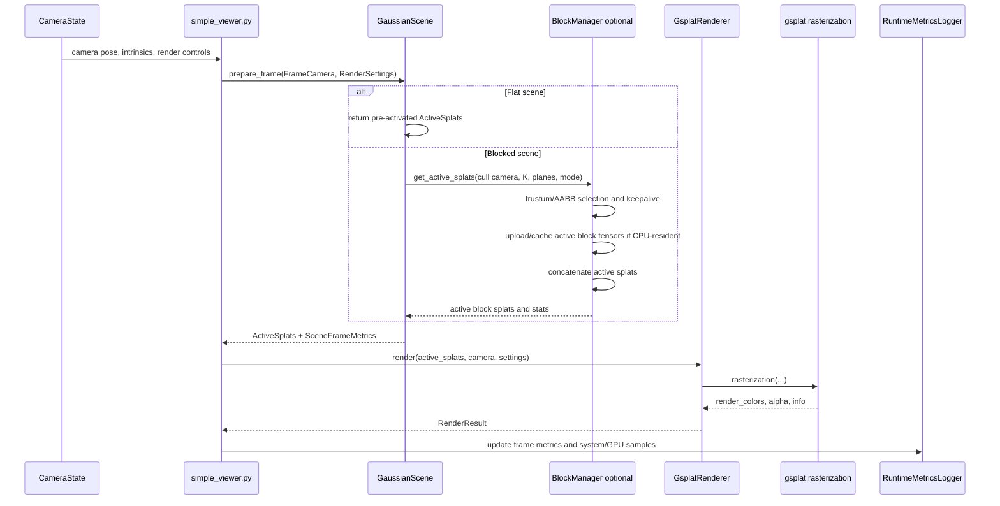

# Architecture

Generated: 2026-07-28

This document describes the current architecture. It does not propose a redesign.

Evidence labels:

- **Verified from source**: checked against current repository files.
- **Verified by lightweight command**: checked with import introspection or Git/file commands.
- **Inferred from source**: reasoned from code paths, not executed end to end here.
- **Needs runtime verification**: command or behavior was not executed in this task.

## Entry Points

Commands are shown for orientation. They were not executed during this task unless explicitly marked.

| Purpose | Entry point | Status |
|---|---|---|
| Viewer, flat or blocked | `python simple_viewer.py --scene PATH [PATH ...] --scene-type auto` | Import and CLI help verified; interactive launch still needs runtime verification |
| Flat rendering API | `scene_runtime.SceneLoader.load(..., scene_type="flat")` plus `GsplatRenderer.render(...)` | Verified from source; modules import; synthetic flat load and renderer construction verified |
| Flat baseline smoke | `python scripts/smoke_baseline.py` | Deterministic tiny flat scene validation; see `docs/BASELINE_VALIDATION.md` |
| Real-scene flat benchmark | `python benchmarks/benchmark_real_scene.py --config-id FLAT-REAL-FIT ...` | Scripted CUDA replay for frozen flat real-scene presets; see `docs/BENCHMARK_PROTOCOL.md` |
| Blocked rendering API | `scene_runtime.SceneLoader.load(..., scene_type="blocked")` plus `GsplatRenderer.render(...)` | Verified from source; modules import |
| Training | `python trainer.py --data-type nerf ...` or `--data-type colmap ...` | Needs runtime verification; `trainer` imports |
| Cleanup | `python cleanup_gaussian_checkpoint.py --input PATH --metadata-output PATH ...` | Needs runtime verification; module imports |
| Checkpoint partitioning | `python partition_checkpoint.py --ckpt PATH --output PATH --grid NX NY` | Needs runtime verification; module imports |
| Tests | `python -m unittest discover -s unit_tests` | Not run here |

## Module Map

| Module | Responsibility | Important dependencies | Evidence |
|---|---|---|---|
| `simple_viewer.py` | Viser/nerfview viewer, runtime scene loading, render callback, metrics logging, block debug UI | `gsplat.distributed.cli`, `nerfview`, `viser`, local `gsplat_viewer.py`, `scene_runtime` | Verified from source; import and help verified |
| `gsplat_viewer.py` | Local gsplat render-tab UI classes `GsplatRenderTabState` and `GsplatViewer` | `nerfview`, `viser`, `scene_runtime.gsplat_compat` | Verified from source; imports with installed `gsplat 1.5.3` |
| `scene_runtime/gsplat_compat.py` | Local type aliases and validation for installed gsplat string-literal APIs | public `gsplat.rendering.rasterization` signature | Verified by lightweight command |
| `scene_runtime/types.py` | Dataclasses for cameras, settings, active splats, render results, scene stats, metrics, block debug info | `torch` | Verified from source |
| `scene_runtime/loader.py` | Detect flat vs blocked payloads and instantiate scene classes | `torch`, `BlockGaussianScene`, `FlatGaussianScene`, `BLOCK_FILE_VERSION` | Verified from source |
| `scene_runtime/scenes.py` | `GaussianScene` interface, `FlatGaussianScene`, `BlockedGaussianScene`, activation of raw splats | `block_manager.BlockManager`, `scene_runtime.ply_splats`, `torch` | Verified from source |
| `scene_runtime/renderer.py` | Shared call into `gsplat.rendering.rasterization` and visible-count extraction | `gsplat.rendering.rasterization`, `torch` | Verified from source; module imports |
| `scene_runtime/citygaussian.py` | CityGaussian V1 runtime cell construction, official visibility, released Nyquist LoD selection, selected-cell assembly, exact-once source-index validation, MAD bounds, and average-scale metadata | `scene_runtime.ply_splats`, `scene_runtime.types`, `torch` | Verified from source; focused tests; CUDA selected-set and render validation |
| `baseline_validation.py` | Tiny deterministic flat-scene fixture, structural checks, CUDA render determinism checks, and smoke-result schema | `scene_runtime`, `torch`, `gsplat` | Validation helper; no viewer server |
| `scripts/smoke_baseline.py` | Non-interactive flat baseline validation command | `baseline_validation.py` | Validation helper; no external data |
| `benchmarks/benchmark_real_scene.py` | Canonical flat-only scripted camera replay for `FLAT-REAL-FIT` and `FLAT-CITYGS-FULL`, including staged PyTorch/NVML memory accounting and non-formal camera sampling | `scene_runtime`, `torch`, `numpy`, optional `pynvml` | No viser/browser; no block, LoD, hierarchy, host residency, or CityGaussian runtime selection |
| `benchmarks/configs/*.json` | Lightweight tracked presets for real-scene flat benchmark configurations | External asset paths supplied by CLI or environment | No mandatory personal absolute checkpoint paths |
| `scene_runtime/ply_splats.py` | Gaussian PLY detection, header validation, field extraction, optional SuperSplat transform | `numpy`, `torch` | Verified from source |
| `block_manager.py` | Block asset format, block construction, frustum/AABB culling, active block assembly, residency/cache stats | `torch`, `gaussian_cleanup` | Verified from source |
| `trainer.py` | Custom training pipeline, dataset loaders, Gaussian initialization, gsplat rasterization, eval/export | `gsplat.rasterization`, `gsplat.strategy`, `torch` | Verified from source; module imports |
| `gaussian_cleanup.py` | Flat checkpoint/PLY validation, diagnostics, bounds/export filters, metadata writing | `scene_runtime.ply_splats`, `torch` | Verified from source |
| `cleanup_gaussian_checkpoint.py` | CLI wrapper around cleanup diagnostics and guarded export pruning | `gaussian_cleanup` | Verified from source |
| `partition_checkpoint.py` | CLI wrapper for block asset construction | `block_manager.build_partitioned_checkpoint` | Verified from source |
| `unit_tests/*` | Unit tests for cleanup, scene runtime, and block manager behavior | current modules | Verified from source; not executed here |

## Module-Level Dependency Diagram

## Production ALoD resident path

The ALoD path is intentionally split into three layers: `alod_dhier` owns the
binary representation, `alod_reference` is the independent CPU correctness
authority, and `scene_runtime/alod` owns renderer-oriented production HSPT,
selection, resident properties, and scene integration. Production frame code
does not call the reference selector.

`AlodResidentScene` keeps activated Gaussian properties on the render device,
keeps source hierarchy/HSPT metadata on CPU, selects stable serialized global
IDs, gathers resident rows in that exact order, and returns the normal
`ActiveSplats` interface. `GsplatRenderer` remains the only renderer. Optional
exact `w2c`, selection center, and full-projection fields on `FrameCamera`
support oracle cameras; all existing callers leave them unset and retain the
previous inverse-`c2w` behavior.

**Verified from source.** The current runtime core is `scene_runtime`; viewer and benchmark-style code should depend on scene abstractions and `GsplatRenderer`, not directly on block-cache internals.

## Production ALoD host-residency path

`AlodHostScene` preserves the resident selector and renderer boundary while
replacing persistent complete-asset GPU properties with `AlodHostProperties`
and one of three ALoD-specific policies: no-cache transfer, exact-row previous
working-set reuse, or a fixed-capacity read-only cache. Stable identity remains
the serialized global node ID. The skybox is a separate non-evictable GPU
prefix; hierarchy slots never contain skybox rows.

Selection/HSPT metadata and cache maps remain on CPU because production
selection is CPU-side. The bounded cache stores only render properties on GPU,
then gathers ordered slots into the contiguous frame arrays required by
gsplat. The cache is project rendering infrastructure, not the official
training write-back/Adam cache. See
`docs/results/alod_host_residency.md` for the validated allocation and identity
contracts.

## Production ALoD pre-materialization path

`scene_runtime/alod/materialization.py` is an opt-in boundary after unchanged
semantic HSPT/SPT selection and before resident property gather or host/cache
lookup. `AlodCompactCullingMetadata` reuses hierarchy means and adds one padded
maximum-scale float per serialized row. For supported pinhole settings it
computes a conservative projected-radius upper bound; unsupported modes retain
the identity materialization set. Stable semantic IDs are never renumbered.

The validated NumPy implementation remains available as
`conservative_pinhole`. The production `conservative_pinhole_gpu` mode copies
the same 16-byte mean/max-scale record per row to the render device once, then
uses eager PyTorch tensor operations to gather, project, mask, and compact the
unchanged ordered semantic IDs. The host/cache path returns only compacted
semantic positions to CPU, reconstructs stable IDs from the existing CPU
selector output, and reuses the compacted GPU IDs for raster identity. It does
not transfer full render properties until after this filter.

`scene_runtime/alod/cache_simulation.py` replays the existing deterministic
protected-current-frame LRU and previous-working-set policies using only the
post-filter request trace. `ALOD-HOST-BOUNDED-CACHE-REDUCED` is a separately
named 160,000-row diagnostic configuration; the historical 525,000-row
configuration is unchanged. See
`docs/results/alod_fast_materialization_culling.md` for exact parity, timing,
memory, and capacity evidence.

ALoD `ActiveSplats` carry their ordered `global_node_ids`, allowing
`GsplatRenderer` to map packed projection-local `gaussian_ids` back to
`backend_projection_survivor_global_node_ids`. The historical visible count is
the packed fully-fused-projection survivor count before tile intersection, not
a final-pixel contribution count. See
`docs/results/alod_materialization_gap.md` for the exact backend trace,
correctness gate, and memory characterization.

## Frame Lifecycle

**Verified from source.** In `simple_viewer.py`, the render path calls `scene.prepare_frame(...)` and then `GsplatRenderer.render(...)`. In blocked mode, `BlockedGaussianScene.prepare_frame` calls `BlockManager.get_active_splats`.

## Data Ownership And Device Placement

### Checkpoint and PLY Loading

**Verified from source.** `FlatGaussianScene` loads flat `.pt/.ckpt` payloads with required splat keys or Gaussian PLY files through `load_gaussian_ply`. It concatenates multiple flat inputs along the Gaussian dimension.

**Verified from source.** `BlockManager._load_raw_splats` loads one or more flat checkpoints or PLYs for offline block construction. `build_partitioned_checkpoint` writes a blocked asset containing metadata and per-block tensors.

### Flat Scene Behavior

**Verified from source.** `FlatGaussianScene.__init__` activates raw splats onto the chosen device using `_activate_raw_splats`; `prepare_frame` returns the same active splat tensors each frame with metrics indicating all Gaussians are active.

### CityGaussian Fixed-All Behavior

**Verified from source.** `CityGaussianFixedAllScene` loads one official finest-LoD PLY, activates the same Gaussian attributes as the flat path, assigns Gaussians to official CityGaussian V1 cells using contraction to unisphere, `block_dim=[6,6,1]`, AABB `[-3.5,-4,-10,4.5,2,10]`, x-fastest cell IDs, half-open cell intervals, MAD bounds with `n=4`, and per-cell average activated scale. `prepare_frame` activates all cells every frame and returns a concatenated all-Gaussian `ActiveSplats`.

**Verified from source.** This path stores stable source indices for validation and diagnostics but does not add source indices to rasterizer-facing Gaussian attributes. It does not use `BlockManager`, host residency, streaming, visibility selection, adaptive LoD, VQ reconstruction, or FlashGS.

### CityGaussian Visibility Behavior

**Verified from source/tests/CUDA validation.** `CityGaussianVisibilityScene` extends the same official cell construction boundary and performs per-frame official V1 block visibility before any future LoD selection. It converts the project runtime camera to the official `world_view_transform`, `projection_matrix`, `full_proj_transform`, and camera-center convention, projects each cell's MAD-bound eight corners, applies the official camera-space `z > 0.2` front-corner test, intersects normalized projected rectangles with `[-1,1]^2`, and forces the nearest cell visible.

**Verified from source.** All Gaussian tensors remain resident in `flat_active`. Visibility selects cell IDs and concatenates only those already-resident cell tensors into `ActiveSplats`; for this implementation `active_gaussian_count = selected_gaussian_count` and `resident_gaussian_count = total_gaussian_count`. This is not host residency, streaming, VQ reconstruction, adaptive LoD, `BlockManager`, or FlashGS.

**Verified by CUDA validation on 2026-07-08.** Runtime selected sets exactly matched the independent oracle for the finest 11,694,810-Gaussian asset and fused 23,389,621-Gaussian asset over the 12 frozen trajectory cameras, including nearest-cell fallback cases.

### CityGaussian Released-LoD Behavior

**Verified from source/tests/CUDA validation on 2026-07-28.** `CityGaussianReleaseLodScene` owns three `CityGaussianFixedAllScene` level structures in released YAML order: `light_50_vq`, `light_66_vq`, and `light_75_vq`. Every level uses the official 36-cell construction and remains GPU-resident. Logical visibility is computed once from the coarsest level's MAD corners.

For each visible cell, `select_citygaussian_release_lod` computes focal length from horizontal FOV, compares every level's average activated scale to `2 * minimum_corner_distance / focal_length` using strict `>`, chooses the first YAML-order match, and falls back to the coarsest level. Assembly groups selected cells by level as the released renderer does and indexes the corresponding resident `ActiveSplats`; `GsplatRenderer` remains the rasterization boundary.

The runtime exposes visible cell IDs, selected LoD indices/labels, per-cell and per-level selected counts, resident/selected/active counts, visibility time, LoD time, assembly time, and policy/integrity flags. It has no paper fixed-distance path, VQ reconstruction, host residency, streaming, or `BlockManager` dependency.

### Blocked Scene Behavior

**Verified from source.** `BlockedGaussianScene.__init__` creates a `BlockManager` from a blocked asset. `prepare_frame` passes culling camera data to `BlockManager.get_active_splats`, then wraps returned tensors into `scene_runtime.types.ActiveSplats`.

### Host-Residency Behavior

**Verified from source.** In `BlockManager.from_file`, `residency="gpu"` activates block tensors onto the target device; `residency="cpu"` keeps activated block tensors on CPU. In CPU-resident mode, `_get_gpu_block_tensors` uploads missing active blocks with `non_blocking=False` and synchronizes CUDA. `_evict_inactive_blocks_if_needed` removes inactive blocks from the GPU cache when a budget is set.

### Rasterization And Synchronization

**Verified from source.** `GsplatRenderer.render` moves the camera to the render device, optionally synchronizes CUDA before/after rasterization for timing, validates the local rasterization-mode string through `scene_runtime.gsplat_compat.normalize_rasterize_mode`, calls `gsplat.rendering.rasterization`, and extracts visible count from returned `info["radii"]` when available.

**Verified by lightweight command.** Installed `gsplat 1.5.3` exposes `rasterization(..., rasterize_mode=Literal["classic", "antialiased"], camera_model=Literal["pinhole", "ortho", "fisheye", "ftheta"], ...)`. It does not export `RasterizeMode` from `gsplat.rendering` or `CameraModel` from `gsplat.cuda._wrapper`, so this repository owns those local aliases.

## Existing Architectural Boundaries For Future Methods

These are connection points, not designs:

- **CityGaussian asset loading.** Could connect at `SceneLoader` or a new `GaussianScene` implementation after defining the exact asset format. Do not force it through `BlockManager` unless the method requires that representation.
- **Runtime block and LoD selection.** Current `GaussianScene.prepare_frame` is the natural boundary for active-set selection. Future LoD selectors can return `ActiveSplats` without coupling to the existing host-residency baseline.
- **Hierarchical representations.** A new scene class could own hierarchy metadata while reusing `GsplatRenderer` for final rasterization.
- **Alternative rasterizers such as FlashGS.** `GsplatRenderer` is the current rasterization wrapper; an alternative renderer should be introduced beside or behind this boundary, with benchmark comparability preserved.
- **Benchmark instrumentation.** `SceneFrameMetrics`, `RenderResult`, and viewer CSV fields are existing places to expose comparable metrics.
- **Real-scene memory accounting.** `benchmarks/benchmark_real_scene.py` owns standardized benchmark memory snapshots. PyTorch allocator metrics are primary for process VRAM; NVML whole-device metrics are supporting context, and process-level NVML accounting is flagged unreliable when it contradicts active PyTorch allocations.

## Current Coupling And Risks

- **Local viewer helper. Verified from source.** `gsplat_viewer.py` is required project source for the current viewer and should be included in the next source-control update.
- **Compatibility layer. Verified by lightweight command.** `scene_runtime.gsplat_compat` replaces stale type-only imports from gsplat internals with local aliases matching the installed public `rasterization` signature.
- **Interactive viewer still needs runtime verification. Needs runtime verification.** Import and CLI/help pass, but a browser/viser session was not launched during this repair.
- **Shared mutable runtime state. Verified from source.** `BlockManager` tracks frame index, active cache key, GPU cache, block residency, and last-used frame data internally.
- **Synchronous GPU transfers. Verified from source.** CPU-resident block uploads use blocking transfer and CUDA synchronize.
- **Duplicated activation logic. Verified from source.** Raw splat activation exists in both `scene_runtime/scenes.py` and `block_manager.py`.
- **Future coupling risk. Inferred from source.** Paper-faithful implementations should avoid depending on `BlockManager` unless the paper method is actually block/cache based; otherwise they may inherit behavior from the experimental baseline accidentally.
