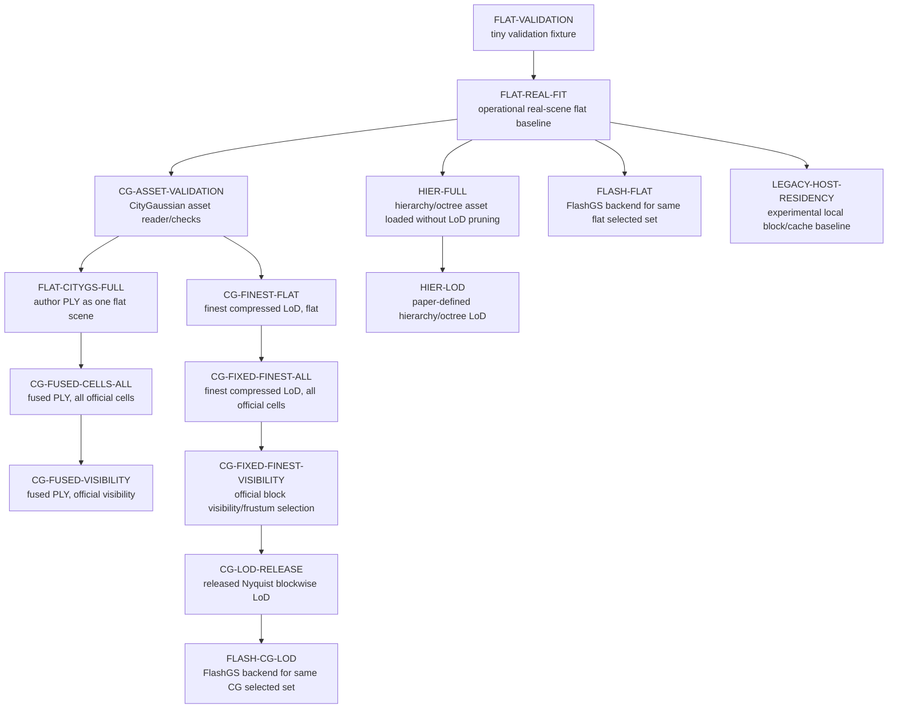

# Experiment Ladder

Generated: 2026-07-06

This document defines an incremental experimental roadmap for evaluating large-scale 3D Gaussian Splatting rendering techniques on one consumer GPU, approximately an RTX 5080-class card with 16 GB VRAM.

It is a research-design document only. It does not claim that any paper method is already reproduced, and it does not implement any method.

## Scope And Principles

The thesis should evaluate paper-defined rendering components incrementally where possible, but it should not force incompatible methods into one universal linear chain.

Core principles:

1. Change one major methodological variable at a time where practical.
2. Within an incremental branch, use the same underlying checkpoint or author-provided asset wherever possible.
3. Do not compare two differently trained checkpoints and attribute the complete difference to a viewer optimization.
4. Separate within-representation incremental ablations, cross-representation comparisons, and rasterizer-backend comparisons.
5. A paper component may be reproduced independently when its scope is explicitly stated.
6. Do not describe a partial viewer-side reproduction as a complete reproduction of the paper.
7. Training quality from author-provided assets must not be attributed to this project.
8. The existing local block/cache runtime remains only an `experimental block-based host-residency baseline`.
9. Do not force all paper methods into one linear chain if their representations are incompatible.

Every configuration in this ladder must state:

- which paper or project baseline it comes from;
- the exact methodological component being evaluated;
- what previous configuration it extends;
- what remains unchanged;
- which checkpoint or asset it uses;
- whether training is author-provided, reproduced, or out of scope;
- whether the comparison is controlled or contains unavoidable confounds.

## Research Questions

RQ1. How much does paper-defined spatial visibility reduce active Gaussian count, peak VRAM, CPU/GPU transfer work, and frame time under fixed cameras and resolution?

RQ2. What additional effect does paper-defined LoD selection have after visibility selection is already enabled?

RQ3. How do block-based LoD representations and hierarchy/octree-based LoD representations differ in active set size, temporal stability, visible artifacts, and memory behavior?

RQ4. How much of end-to-end frame time is attributable to selection, active-set preparation or concatenation, CPU-to-GPU transfer, and rasterization?

RQ5. How does changing only the rasterizer backend affect an otherwise identical checkpoint, camera, resolution, selected Gaussian set, and render-parameter configuration?

RQ6. Which methods remain usable under a 16 GB VRAM constraint for city-scale or digital-twin scenes?

RQ7. Which quality and interaction artifacts appear as scene organization becomes more aggressive, such as seams, missing chunks, LoD popping, color mismatch, or visible temporal instability?

## Terminology

**Baseline**: A comparison point with clearly stated behavior and assets. A baseline is not necessarily simple or paper-faithful; it must be explicit.

**Configuration**: One concrete experiment setting: representation, asset, selection rules, LoD rules, residency mode, rasterizer, cameras, resolution, and metrics.

**Incremental step**: A configuration that extends exactly one parent configuration by changing one major methodological variable where practical.

**Within-branch ablation**: A comparison between configurations that share the same representation and preferably the same checkpoint or author-provided asset. These are the safest comparisons for attributing performance or quality differences to one runtime component.

**Cross-representation comparison**: A comparison between assets or representations that differ structurally, such as CityGaussian chunks versus a hierarchy or octree. These comparisons can be useful for thesis-level trade-offs but cannot attribute differences to a single viewer component.

**Author-provided asset**: A checkpoint, chunked scene, LoD asset, hierarchy, octree, or other preprocessed representation released by a paper or project authors. It may be used to evaluate rendering behavior without reproducing training, but its training quality is external.

**Viewer-side reproduction**: A reproduction of runtime loading, selection, LoD, residency, or rendering behavior using existing assets. It does not reproduce training unless explicitly stated.

**Full-paper reproduction**: A reproduction that covers the paper's training or asset-construction pipeline plus runtime behavior and evaluation protocol. No current source evidence shows that this repository contains a full-paper reproduction.

**Rasterizer backend**: The implementation that turns the selected Gaussian set into pixels, such as `gsplat` or a future FlashGS integration. Backend comparisons are only controlled when the selected Gaussian set and render parameters are identical.

**Total Gaussians**: The number of Gaussians in the full loaded asset or representation. Current flat scene stats expose this for flat inputs.

**Active Gaussians**: Current project metric for Gaussians passed from a scene's `prepare_frame(...)` into the renderer. In the flat baseline, all loaded Gaussians are active every frame. In the blocked path, this is the concatenated active block set.

**Selected Gaussians**: The conceptual set chosen by visibility, LoD, hierarchy traversal, or another selection method before rasterization. In current flat and blocked code, this usually corresponds to active Gaussians, but future methods should expose this explicitly when selection and residency differ.

**Visible Gaussians**: Current renderer metric extracted from `gsplat` `info["radii"]` when available. It counts Gaussians with positive projected radius according to the current `_visible_count(...)` logic. This may not equal paper-specific visibility definitions.

**Resident Gaussians**: Gaussians currently held in persistent GPU-resident storage or cache. Current host-residency metrics expose this for the experimental block/cache path, not for flat scenes.

**Rendered or intersected Gaussians**: A backend-reported count of Gaussians actually touched by rasterization. Current `GsplatRenderer` exposes projected visible count from radii when available; a future backend may expose more precise intersected or rendered counts.

Unresolved definitions must be recorded per method card. In particular, paper-specific meanings of visibility, LoD level, chunk, node, and rendered Gaussian count must not be assumed from local metric names alone.

## Experiment Graph

The experiment design is a DAG. It has related branches, not one universal ladder.

### Flat Baseline Branch

`FLAT-VALIDATION` uses the deterministic five-Gaussian fixture from `docs/BASELINE_VALIDATION.md`. It proves the flat loading and rendering path is operational. It is validation only and must not be treated as a performance benchmark.

`FLAT-REAL-FIT` freezes the operational real-scene flat baseline using the existing project-trained MatrixCity/splatfacto flat checkpoint and its own manually authored trajectory. It uses no block visibility, no LoD, no host residency, no hierarchy, no CityGaussian runtime behavior, and the `gsplat` rasterizer. A short non-formal validation succeeded with 1,227,788 active Gaussians; formal benchmark results still require the full protocol.

### CityGaussian V1 Branch

This branch should use one author-provided CityGaussian V1 asset wherever feasible. The branch must begin with a CityGaussian V1 method card that verifies paper claims, asset format, official code behavior, and evaluation scope before implementation.

Method-card audit status from 2026-07-06:

- `CG-ASSET-VALIDATION` is implemented as metadata/config/header/NPZ validation only.
- `FLAT-CITYGS-FULL` remains the valid no-LoD fused-PLY reference for the author-provided 23,389,621-Gaussian CityGaussian asset.
- `CG-FULL-DETAIL` must distinguish the fused no-LoD PLY from the finest compressed LoD. Use `FLAT-CITYGS-FULL` or `CG-FULL-DETAIL-NOLOD` for the fused-Ply reference, and `CG-FIXED-FINEST-*` for the finest official compressed LoD.
- `CG-FINEST-FLAT` and `CG-FIXED-FINEST-ALL` are implemented and CUDA-validated same-asset fixed-finest references. The latter constructs official runtime cells and activates all 36 cells; it is not visibility or adaptive LoD.
- `CG-FIXED-FINEST-VISIBILITY` is implemented and CUDA-validated against the independent selected-set oracle. It uses the same finest PLY and official 36 cells as `CG-FIXED-FINEST-ALL`, changes only visibility selection, keeps all Gaussian data resident, and renders finite output over the 12 oracle cameras.
- `CG-FUSED-CELLS-ALL -> CG-FUSED-VISIBILITY` is implemented and CUDA-validated as a controlled fused no-LoD branch. `CG-FUSED-CELLS-ALL` is image-equivalent to `FLAT-CITYGS-FULL` over the 12 oracle cameras; `CG-FUSED-VISIBILITY` matches the fused oracle selected sets and renders finite output.
- `CG-LOD-RELEASE` is implemented and CUDA-validated against the authoritative Spec 004 fixture. It follows the inspected source Nyquist rule; the paper fixed-distance fixture remains separate, provisional, and unimplemented.

Proposed sequence:

1. `CG-ASSET-VALIDATION`: validate and load the official asset format without claiming runtime reproduction.
2. `FLAT-CITYGS-FULL`: attempt to render the author-provided CityGaussian fused PLY as one ordinary flat, fully resident scene without visibility culling or LoD.
3. `CG-FINEST-FLAT`: render the finest official compressed LoD as one flat all-active scene.
4. `CG-FIXED-FINEST-ALL`: construct official runtime cells for the same finest LoD and activate all cells.
5. `CG-FIXED-FINEST-VISIBILITY`: add official block visibility or frustum selection to the finest fixed-detail parent.
6. `CG-LOD-RELEASE`: add released-code Nyquist blockwise LoD selection.
7. Additional viewer-side CityGaussian behavior only after it is verified from the paper and official implementation.

Parallel fused no-LoD visibility isolation:

1. `FLAT-CITYGS-FULL`: render the 23,389,621-Gaussian fused PLY as one flat fully active scene.
2. `CG-FUSED-CELLS-ALL`: construct official 36 runtime cells for the same fused PLY and keep all cells active.
3. `CG-FUSED-VISIBILITY`: use the same fused PLY and change only the official visibility-selected active cells.

Observed feasibility result: `FLAT-CITYGS-FULL` successfully rendered one configured frame after reading a PLY header with 23,389,621 vertices. All 23,389,621 Gaussians were active, output image and alpha were finite, and no CityGaussian visibility, LoD, block, hierarchy, or host-residency path was used. A non-formal 12-frame camera sample over the same trajectory showed radii-derived visible counts from 1,632,297 to 20,555,870 and render peak allocated VRAM from about 7.42 GB to 8.15 GB, while scene construction peaked higher at about 10.01 GB allocated due to flat activation. This is a flat-path feasibility result, not a CityGaussian visibility or LoD result and not a formal benchmark. Asset validation later verified the three official compressed LoD levels and showed that `light_50_vq` is a pruned SH2 complete-scene alternative, not the same representation as the fused no-LoD PLY.

Observed fixed-finest validation result: on 2026-07-06, `CG-FINEST-FLAT` and `CG-FIXED-FINEST-ALL` rendered the same `light_50_vq/point_cloud.ply` asset over 1 warmup and 3 measured frames on the host RTX 5080. Both paths used 11,694,810 active/selected Gaussians and produced finite RGB/alpha. `CG-FIXED-FINEST-ALL` activated all 36 official cells and matched the flat path exactly on frames `[0, 1, 2]` with RGB and alpha max absolute difference `0.0`. This is a short validation, not a formal benchmark.

Formal campaign result: on 2026-07-30, the CityGaussian branch completed a full 1,440-frame formal benchmark campaign under `/tmp/citygs_formal_bench_20260730_121148/`. All seven implemented configurations ran as `formal_benchmark`: `CG-FINEST-FLAT`, `CG-FIXED-FINEST-ALL`, `CG-FIXED-FINEST-VISIBILITY`, `CG-LOD-RELEASE`, `FLAT-CITYGS-FULL`, `CG-FUSED-CELLS-ALL`, and `CG-FUSED-VISIBILITY`. The fused branch did not need a reduced sample.

Formal controlled transitions supported by that package:

- `CG-FINEST-FLAT -> CG-FIXED-FINEST-ALL`: official cell organization on the same finest released LoD asset; selected Gaussian count unchanged; sampled image comparison showed zero alpha difference and tiny RGB drift only (`7.65e-05` max absolute difference), below the comparison threshold.
- `CG-FIXED-FINEST-ALL -> CG-FIXED-FINEST-VISIBILITY`: official visibility on the same finest released LoD asset; mean selected Gaussians fell by `49.22%`; mean frame time improved by `5.64%`.
- `CG-FIXED-FINEST-VISIBILITY -> CG-LOD-RELEASE`: released-code Nyquist LoD after visibility; mean selected Gaussians fell by `29.04%`; mean frame time improved by `29.09%`; render peak allocated VRAM rose by about `0.96 GB` because all three levels are resident.
- `FLAT-CITYGS-FULL -> CG-FUSED-CELLS-ALL`: official cell organization on the same fused 23M no-LoD asset; selected Gaussian count unchanged; sampled image comparison had exact zero RGB/alpha difference.
- `CG-FUSED-CELLS-ALL -> CG-FUSED-VISIBILITY`: official visibility on the fused 23M no-LoD asset; mean selected Gaussians fell by `49.41%`, but mean frame time worsened by `130.60%`, so this should be reported separately from the released-LoD branch.

Do not treat `FLAT-CITYGS-FULL -> CG-LOD-RELEASE` as an isolated-method transition. It changes representation, SH degree, Gaussian count, visibility behavior, and LoD behavior together.

### Hierarchical Or Octree Branch

Hierarchy-based methods should be represented as separate branches when their underlying representation differs from CityGaussian. Potential candidates include Hierarchical 3D Gaussians, A LoD of Gaussians, and Octree-GS.

Do not claim that these methods can be added directly on top of CityGaussian unless a method card verifies compatible representation, asset construction, traversal rules, and rendering assumptions.

2026-07-30 selection-audit note: the CityGaussian V1 released-code branch is complete through the formal benchmark campaign and persistent package. The next planning memo is `docs/planning/next_sota_selection_after_citygaussian.md`; it recommends auditing Hierarchical 3DGS first, with LODGE as the close alternative if paper/repository/asset evidence is stronger. This is an audit target only, not an implementation decision.

2026-08-22 ALoD completion note: the separate ALoD hierarchy branch completed
the faithful public-source evaluation gate
`PASS-ALOD-FAITHFUL-REPRODUCTION`. The frozen package is
`/home/luis/tese/benchmark_artifacts/alod_faithful_reproduction_001/` and the
memo is `docs/results/alod_faithful_reproduction.md`. The completed ladder is
`ALOD-REPRO-HOST-NOCACHE`, `ALOD-REPRO-NOFRUSTUM`, HSPT/BFS cut-only, released
viewer previous-working-set reuse, official-path quality, and the 71-camera LoD
characterization. Paper `Render Full` is explicitly unavailable; the project
160k/525k caches and prematerialization filters remain `ALOD-EXT` experiments
and were not used in this reproduction campaign.

### Rasterizer Branch

`gsplat` versus FlashGS is a backend comparison only where both backends can render the same representation and selected Gaussian set.

Required controls:

- identical checkpoint or author-provided asset;
- identical camera and camera convention;
- identical resolution;
- identical selected Gaussians;
- identical SH degree and rendering parameters where supported;
- identical background and near/far/radius settings where supported.

Backend comparisons should be introduced only after selected-set equivalence is established and logged.

### Legacy Experimental Branch

The existing local block-based host-residency code is a separate historical or experimental baseline. It can help understand local memory behavior, active block counts, upload cost, and cache behavior, but it must not be placed in a paper-faithful chain unless later evidence proves methodological equivalence to a specific paper component.

## Configuration Table

| ID | Parent | Representation | Source paper or baseline | Asset/checkpoint | Training source | Enabled runtime components | Disabled runtime components | Rasterizer | Expected metrics affected | Comparison purpose | Known confounds | Status |
|---|---|---|---|---|---|---|---|---|---|---|---|---|
| `FLAT-VALIDATION` | none | Tiny flat checkpoint | Project validation baseline | Generated five-Gaussian fixture | Out of scope; synthetic fixed values | Flat load, tensor activation, fixed camera render | Real scene, block visibility, LoD, host residency, streaming, FlashGS | `gsplat` | Import success, shapes, determinism, valid output values | Prove baseline path is operational | Not a performance benchmark; not representative | Implemented validation path |
| `FLAT-REAL-FIT` | `FLAT-VALIDATION` | Flat Gaussian checkpoint | Project flat gsplat baseline | Existing project-trained MatrixCity/splatfacto flat checkpoint supplied externally | Project-trained | Flat scene loading, all Gaussians active, scripted camera replay, benchmark validation outputs | Block visibility, LoD, host residency, hierarchy, CityGaussian-specific behavior | `gsplat` | Frame time, FPS, peak VRAM, total/active/visible Gaussians, quality if fixed GT exists | Successful real-scene reference for future deltas | Timing from short validation is not formal benchmark performance | Operational by short validation |
| `FLAT-CITYGS-FULL` | `FLAT-REAL-FIT` | Author-provided Gaussian PLY loaded as one flat scene | CityGaussian asset feasibility through project flat baseline | Author-provided fused PLY supplied externally | Author-provided; training not reproduced | Ordinary flat-scene loading attempt, no partitioning, no LoD, no selection | Blocks, official CityGaussian visibility, official CityGaussian LoD, host residency, hierarchy, precision changes, FlashGS | `gsplat` | Feasibility, CPU RAM, PyTorch allocator VRAM, NVML whole-device memory, frame time, visible/rendered proxy count, finite output flags, failure stage if any | Determine whether the full fused asset can render as one flat fully resident scene under 16 GB VRAM and estimate the camera-dependent memory envelope | Cross-asset; one-frame feasibility and 12-frame sample are not formal benchmarks and should not be over-interpreted as interactive performance | One-frame feasibility success and 12-frame memory sample observed |
| `CG-ASSET-VALIDATION` | `FLAT-CITYGS-FULL` | CityGaussian V1 fused PLY plus official LoD/config/VQ metadata | CityGaussian V1 | Author-provided fused PLY, official config, and three official compressed LoD directories under `/home/luis/tese/mc_aerial_c36/LoD` | Author-provided; training not reproduced | Asset discovery, config/header/NPZ validation, official-vs-local classification, readiness reporting | Rendering claims, visibility, LoD, FlashGS, host residency | none | Asset counts, sizes, config block count, LoD/VQ metadata, YAML order, official cell coverage | Establish official asset validity before runtime claims | Does not prove selected-set behavior or image equivalence | Implemented metadata validation |
| `CG-FINEST-FLAT` | `CG-ASSET-VALIDATION` | Finest official compressed LoD loaded as one flat scene | CityGaussian V1 fixed-detail parent | `/home/luis/tese/mc_aerial_c36/LoD/mc_aerial_c36_light_50_vq/point_cloud.ply` | Author-provided | Flat all-active rendering of the finest LoD PLY | Cell construction, visibility culling, adaptive LoD, non-official host cache, FlashGS | `gsplat` | Active Gaussian count, VRAM, frame time, radii-derived visible count | Same-asset parent for `CG-FIXED-FINEST-ALL` | Not equivalent to fused no-LoD PLY; official renderer uses GraphDECO backend | CUDA-validated by short run |
| `CG-FIXED-FINEST-ALL` | `CG-FINEST-FLAT` | Same finest official compressed LoD divided into official runtime cells with all cells active | CityGaussian V1 fixed-detail parent | Same `light_50_vq/point_cloud.ply` asset | Author-provided | Official runtime cell construction only; all cells active; no visibility | Adaptive LoD, visibility culling, non-official host cache, FlashGS, streaming, custom project partition | `gsplat` | Active/selected Gaussian count, cell counts, cell-construction time, concat/prep time, VRAM, frame time | Controlled fixed-detail parent for visibility | Block concatenation can reorder Gaussians; official renderer uses GraphDECO backend | CUDA-validated; exact RGB/alpha match to flat parent over short run |
| `CG-FIXED-FINEST-VISIBILITY` | `CG-FIXED-FINEST-ALL` | Same finest official compressed LoD with official block visibility/frustum selection | CityGaussian V1 component: official block visibility/frustum selection | Same `light_50_vq` asset divided into official 36 runtime cells | Author-provided | Official visibility selection, selected/active/resident metrics | Adaptive LoD, non-official host cache, streaming, FlashGS | `gsplat` | Selection time, active/selected Gaussians, visible blocks, VRAM, frame time | Measure visibility effect alone on the fixed finest branch | Rasterizer remains project `gsplat` backend | Implemented; oracle and render validation passed |
| `CG-FUSED-CELLS-ALL` | `FLAT-CITYGS-FULL` | Same fused no-LoD PLY divided into official runtime cells with all cells active | CityGaussian V1 no-LoD fused representation plus official runtime cell construction | Same 23,389,621-Gaussian fused PLY as `FLAT-CITYGS-FULL` | Author-provided | Official runtime cell construction only; all cells active | Visibility, adaptive LoD, host residency, streaming, FlashGS | `gsplat` | Cell construction, all-active selected count, image equivalence against flat parent | Controlled parent for fused visibility | Large fused all-cell rendering may be heavier than fixed-finest branch | Implemented; flat image-equivalence validation passed |
| `CG-FUSED-VISIBILITY` | `CG-FUSED-CELLS-ALL` | Same fused no-LoD PLY with official block visibility/frustum selection | CityGaussian V1 component: official block visibility/frustum selection on no-LoD fused asset | Same 23,389,621-Gaussian fused PLY | Author-provided | Official visibility selection, selected/active/resident metrics | Adaptive LoD, host residency, streaming, FlashGS | `gsplat` | Selection time, active/selected Gaussians, visible blocks, VRAM, frame time | Isolate visibility relative to original 23M flat baseline | Fused representation differs from compressed LoD branch; rasterizer remains project `gsplat` backend | Implemented; oracle and render validation passed |
| `CG-LOD-RELEASE` | `CG-FIXED-FINEST-VISIBILITY` | Same official LoD asset family | CityGaussian V1 released-code blockwise LoD | Official `light_50_vq`, `light_66_vq`, `light_75_vq` assets | Author-provided | Official visibility plus released strict Nyquist selection | Paper fixed-distance LoD, non-official host cache, VQ reconstruction, streaming, unrelated hierarchy methods, FlashGS | `gsplat` | LoD level distribution, selected Gaussians, frame time, VRAM, quality/artifacts | Measure released LoD effect after visibility | All three levels remain resident; official renderer uses GraphDECO rather than `gsplat` | Implemented; exact oracle and finite render validation passed |
| `HIER-ASSET-VALIDATION` | `FLAT-REAL-FIT` | Hierarchy/octree representation | Candidate paper, e.g. Hierarchical 3D Gaussians, A LoD of Gaussians, or Octree-GS | Official hierarchy/octree asset if available | Author-provided or reproduced asset construction; record exact source | Asset validation, bounds/nodes/levels checks | CityGaussian assumptions, FlashGS, local host residency | none or `gsplat` sanity if valid | Node counts, level counts, memory footprint | Establish separate representation branch | Different representation from flat/CityGaussian | Planned after CG branch starts |
| `HIER-FULL` | `HIER-ASSET-VALIDATION` | Hierarchy/octree all-detail or no-pruning mode | Candidate hierarchy/octree paper | Same hierarchy/octree asset | Author-provided or reproduced asset construction | Load full hierarchy leaves or highest detail where semantically valid | Paper LoD traversal, CityGaussian visibility, local cache | `gsplat` if compatible | Active Gaussians, VRAM, frame time, feasibility | Full-detail reference within hierarchy branch | May be invalid for some hierarchy formats | Proposed |
| `HIER-LOD` | `HIER-FULL` | Hierarchy/octree with paper LoD | Candidate hierarchy/octree paper | Same hierarchy/octree asset | Author-provided or reproduced asset construction | Paper-defined traversal/LoD selection | CityGaussian LoD, local host cache, FlashGS | `gsplat` first where possible | Selection time, active nodes, selected Gaussians, frame time, VRAM, quality/artifacts | Measure hierarchy LoD effect within its own representation | Cross-paper implementation differences; asset construction may dominate quality | Proposed |
| `FLASH-FLAT` | `FLAT-REAL-FIT` | Same flat checkpoint as `FLAT-REAL-FIT` | FlashGS or other backend paper/project | Same flat checkpoint as `FLAT-REAL-FIT` | Same as `FLAT-REAL-FIT` | Flat selected set, FlashGS-compatible render parameters | Visibility, LoD, host residency | FlashGS | Rasterization time, frame time, backend memory | Isolate backend effect for flat selected set | Controlled only if backend supports equivalent rendering parameters | Future |
| `FLASH-CG-LOD` | `CG-LOD-RELEASE` | Same selected CityGaussian Gaussians as `CG-LOD-RELEASE` | FlashGS backend comparison plus CityGaussian selected set | Same CityGaussian asset and same selected chunks/LoD | Author-provided | Official CG selection/LoD, FlashGS rasterization | Changes to selection, asset, cameras, resolution | FlashGS | Rasterization time, frame time, backend memory | Isolate backend effect after CG selected-set equivalence | Invalid if selected set or render parameters differ | Future |
| `LEGACY-HOST-RESIDENCY` | `FLAT-REAL-FIT` or relevant partitioned asset | Local blocked asset from flat checkpoint or PLY | Project experimental block-based host-residency baseline | Project partitioned asset, e.g. local partitioned checkpoints outside source | Same checkpoint source as input asset | Local block selection, optional CPU-resident cache, upload/cache metrics | Paper-defined CityGaussian visibility/LoD, hierarchy traversal, FlashGS | `gsplat` | Upload time, cache hit/miss, resident Gaussians, active blocks, frame time, VRAM | Historical/local memory-management comparison | Not paper-faithful; partitioning may differ from official assets | Existing experimental baseline |

## Comparison Validity Matrix

| Comparison | Classification | Why |
|---|---|---|
| `FLAT-VALIDATION` vs anything performance-related | Invalid or misleading | The five-Gaussian fixture is only a deterministic operational check. It is not representative of performance, memory behavior, or quality. |
| `FLAT-REAL-FIT` vs `FLAT-CITYGS-FULL` using different checkpoints/assets | Cross-asset and partially controlled | It can show practical feasibility differences, but training, asset format, representation source, trajectory, and scale differ. Do not attribute the difference only to viewer optimization. |
| Project-trained flat splat vs author-provided CityGaussian model | Partially controlled at best | The author-provided checkpoint includes external training/asset-construction quality. This project must not claim that quality as its own result. |
| Future official all-cells parent vs matching visibility configuration on the same author asset | Controlled if the parent mode is valid | Same representation and asset; major variable is official visibility selection. |
| `CG-FIXED-FINEST-VISIBILITY` vs `CG-LOD-RELEASE` on the same author asset family | Controlled runtime selection with a residency caveat | Same finest asset, visibility path, cameras, and renderer; the child additionally requires resident middle/coarsest assets and changes per-cell level selection. Quality effects depend on author-provided LoD asset construction. |
| `CG-LOD-RELEASE` vs `HIER-LOD` | Cross-representation | Useful thesis comparison of method families, but representation, asset construction, traversal, and training may differ. It cannot isolate LoD alone. |
| `FLAT-REAL-FIT` with `gsplat` vs `FLASH-FLAT` | Controlled if selected set and render parameters match | Same flat checkpoint, camera, resolution, and selected Gaussians isolate rasterizer backend as the major variable. |
| `CG-LOD-RELEASE` with `gsplat` vs `FLASH-CG-LOD` | Controlled only after selected-set equivalence is proven | Backend comparison is valid only if the same CityGaussian-selected Gaussians and render parameters are used. |
| `LEGACY-HOST-RESIDENCY` vs paper-defined out-of-core method | Partially controlled or invalid until method-card verified | Local host residency may measure useful memory behavior, but it is not a verified reproduction of any paper-defined out-of-core policy. |
| `LEGACY-HOST-RESIDENCY` all-blocks-active vs `FLAT-REAL-FIT` from the same checkpoint | Partially controlled | Can test local partition/assembly overhead and visual equivalence, but partitioning and concatenation introduce behavior absent from flat rendering. |
| Different trained checkpoints evaluated with the same viewer | Partially controlled | Useful for practical asset comparison, but viewer/runtime differences are not isolated from training quality and Gaussian count. |

## Metrics By Configuration

| Metric | Flat validation | Flat real | CityGaussian full/visibility/LoD | Hierarchy/octree branch | Rasterizer branch | Legacy host residency | Current runtime exposure |
|---|---:|---:|---:|---:|---:|---:|---|
| Frame time | yes, validation only | yes | yes | yes | yes | yes | `RenderResult.render_time_ms`, viewer CSV |
| Rasterization time | optional | desired | desired | desired | required | desired | GPU event field exists but is not always recorded; needs benchmark discipline |
| Selection time | no | no | required for visibility/LoD | required | should be unchanged | required | Current block path has `block_cull_ms`; future methods need explicit fields |
| Preparation or concatenation time | no | low priority | required | required | should be unchanged | required | Current block path has `block_concat_ms`; future methods need explicit fields |
| Upload or transfer time | no | no unless streaming | maybe if method streams | maybe if method streams | should be unchanged | required | Current block path has `gpu_upload_ms`; future methods need explicit fields |
| FPS | no benchmark | yes | yes | yes | yes | yes | Viewer metrics |
| Peak VRAM | validation sanity only | yes | yes | yes | yes | yes | Torch/CUDA peak fields in viewer; benchmark runner should standardize |
| CPU RAM | no | yes | yes | yes | maybe | yes | Metrics logger can sample process/system RAM |
| Total Gaussians | yes | yes | yes | yes | yes | yes | Scene stats for current flat/blocked paths; future methods need stats |
| Active Gaussians | yes | yes | yes | yes | yes | yes | `SceneFrameMetrics.active_gaussians` |
| Visible blocks or nodes | no | no | required | required | should be unchanged | active blocks only | Blocks exposed in current blocked path; hierarchy nodes not yet exposed |
| Selected Gaussians | active count proxy | active count proxy | required | required | required equivalence check | active count proxy | Not a separate current field; should be added for future methods |
| Resident Gaussians | no | no | method-dependent | method-dependent | should be unchanged | yes | Current host-residency path exposes resident metrics |
| Rendered/intersected Gaussians | visible proxy | visible proxy | visible proxy or backend-specific | visible proxy or backend-specific | required | visible proxy | Current `gsplat` radii-derived visible count; true intersect count unresolved |
| Bytes transferred | no | no | method-dependent | method-dependent | should be unchanged | required | Not generally exposed; cache path has byte residency metrics, not transfer bytes |
| Cache hits/misses | no | no | only if paper method caches | only if method caches | should be unchanged | yes | Current host-residency path exposes cache hit/miss metrics |
| PSNR, SSIM, LPIPS | no | yes if fixed GT exists | yes if cameras/GT valid | yes if cameras/GT valid | yes if output equivalent | yes if fixed GT exists | Evaluation tooling not yet consolidated; `lpips` currently unavailable in environment docs |
| Image difference against official renderer | no | no | recommended | recommended | recommended | no | Not currently exposed; requires official renderer outputs |
| LoD popping or temporal instability | no | no | required for LoD | required for LoD | should be unchanged | maybe | Not currently automated; needs camera paths and visual/temporal checks |

Metrics not currently exposed should be listed as implementation requirements in the method card before coding starts. Do not overload existing metric names if a paper uses a different definition.

## Dataset And Asset Policy

Asset categories:

- **Tiny synthetic fixtures**: Small deterministic fixtures such as `tiny_flat_gaussians_v1`. These belong in source or are generated by source and are for validation only.
- **Project-owned checkpoints**: Checkpoints trained or prepared by this project. They can support baselines and stress tests, but their training quality must be documented.
- **Official paper checkpoints**: Author-provided models used to evaluate runtime behavior. They may be used without reproducing training when the document says training is author-provided and out of scope.
- **Official preprocessed LoD/hierarchy assets**: Author-provided chunk, LoD, hierarchy, or octree representations. These are preferred for viewer-side reproduction when reproducing asset construction would be too expensive or outside scope.
- **MatrixCity evaluation cameras and ground truth**: Fixed cameras and images used for quality evaluation when camera conventions and coordinate transforms are valid.

Policy:

- Large datasets, checkpoints, generated assets, rendered outputs, logs, and third-party repositories stay outside tracked source.
- Use command-line arguments, environment variables, ignored local config, or documented path settings for external assets.
- An author-provided checkpoint may be used without reproducing training when the configuration states `training source = author-provided` and quality claims are scoped accordingly.
- A viewer-side reproduction may evaluate runtime behavior on an official asset, but it must not claim full-paper reproduction unless training or asset construction is also reproduced and validated.
- Fixed-camera evaluation must be used before making image-quality claims across checkpoints.
- Do not compare a project-trained splat with an author-provided paper asset and attribute the full difference to a rendering optimization.

## Recommended Implementation Order

1. Maintain `FLAT-REAL-FIT`: keep the chosen real-scene flat checkpoint role, fixed camera path, resolution set, and metric fields stable. Keep `FLAT-VALIDATION` as a smoke gate, not a benchmark.
2. Treat the CityGaussian V1 released-code branch as complete for the current ladder: method card, asset validation, visibility, released LoD, same-asset controls, and full formal benchmark package are recorded.
3. Preserve the CityGaussian formal package at `/home/luis/tese/benchmark_artifacts/citygs_formal_bench_20260730_121148/` and cite `docs/results/citygaussian_v1_released_benchmark_memo.md` for thesis-facing numbers.
4. Introduce a separate hierarchy/octree branch only after selecting a specific paper and writing its method card.
5. Audit Hierarchical 3DGS first unless LODGE has clearer official code/assets after source discovery.
6. Compare rasterizer backends only after selected-set equivalence is established for the representation under test.
7. Use `LEGACY-HOST-RESIDENCY` as a historical/local systems comparison, not as evidence of paper-faithful reproduction.

## Documentation Gate For New Configurations

Before adding runtime code for any configuration, create or update the relevant method card or implementation spec with:

- paper/project name and citation target;
- asset source and license/usage assumptions;
- representation and coordinate conventions;
- selected/active/visible/resident/rendered Gaussian definitions;
- exact parent configuration and one-variable change;
- expected controlled comparisons and known confounds;
- required metrics and which are not yet exposed;
- validation commands that prove the configuration is operational.

This gate is meant to keep the thesis ladder methodologically honest as the implementation grows.

## ALoD Residency Ladder

| Configuration | Selection | Residency | Status |
|---|---|---|---|
| `ALOD-HIER-FINEST-RESIDENT` | Skybox plus valid serialized hierarchy leaves | All properties resident | Formal resident benchmark complete |
| `ALOD-HIER-LOD-RESIDENT` | HSPT LoD, frustum rejection disabled | All properties resident | Formal resident benchmark complete |
| `ALOD-HIER-LOD-FRUSTUM` | HSPT LoD plus official-equivalent four-plane frustum | All properties resident | Exact parity and formal resident benchmark complete |
| `ALOD-HOST-NOCACHE` | Same validated LoD/frustum IDs | Complete render-ready host table; per-frame hierarchy transfer; resident skybox | Ten-camera correctness/render gate complete |
| `ALOD-HOST-PREVIOUS-REUSE` | Same validated LoD/frustum IDs | Exact rows retained only from previous working set; resident skybox | Ten-camera and deterministic-sequence gate complete |
| `ALOD-HOST-BOUNDED-CACHE` | Same validated LoD/frustum IDs | 525,000-row read-only hierarchy cache; separate 100,000-row skybox | Ten-camera, render, capacity, and deterministic-sequence gate complete |
| `ALOD-HOST-BOUNDED-CACHE-PREMATERIALIZATION` | Same semantic IDs; CPU conservative materialization subset | Unchanged 525,000-row property cache | Exact ten-camera memory/correctness characterization complete |
| `ALOD-HOST-BOUNDED-CACHE-REDUCED` | Same semantic IDs; exact PyTorch CUDA conservative materialization subset | Separate 160,000-row property cache selected by deterministic trace replay | Fast-filter correctness and bounded characterization complete; formal campaign pending |

The resident-only comparison is frozen as `ALOD-RESIDENT-BENCHMARK-001`; see
`docs/results/alod_resident_ablation_benchmark.md`. Host modes were added later
and validated separately in `docs/results/alod_host_residency.md`; no historical
resident result changed. The original four-way host campaign is complete. The
next bounded ladder action is the formal materialization-aware benchmark with
the fast filter and 160,000-row cache. Prefetching, asynchronous transfer,
selector changes, and custom CUDA remain outside the current path.

### Formal Run009 ALOD-EXT ladder

The Run005 rows above remain development history. The formal mixed-scale
Run009 campaign is complete under `PASS-ALOD-EXT-FORMAL-RUN009` with new
trajectory-derived capacities rather than the historical 160k/525k values.

| Configuration | Existing extension isolated | Run009 status |
|---|---|---|
| `ALOD-EXT-ROW-LRU-PRACTICAL` | Unfiltered bounded full-property row cache, 3.70M rows | Complete |
| `ALOD-EXT-PREMATERIALIZATION-CPU-PRACTICAL` | Validated conservative CPU filter, 3.70M cache | Complete |
| `ALOD-EXT-PREMATERIALIZATION-CUDA-PREVIOUS` | Exact CUDA filter with previous-working-set reuse | Complete; fastest existing mode |
| `ALOD-EXT-PREMATERIALIZATION-CUDA-MINIMUM` | CUDA filter, measured 1,599,906-row minimum | Complete; memory/traffic sensitivity |
| `ALOD-EXT-PREMATERIALIZATION-CUDA-PRACTICAL` | CUDA filter, 3.70M union-plus-headroom cache | Complete; practical bounded-cache mode |
| `ALOD-EXT-PREMATERIALIZATION-CUDA-LARGE` | CUDA filter, 5.30M larger sensitivity cache | Complete |

See `docs/results/alod_ext_formal_run009.md`. Semantic-selector changes remain
outside this completed campaign.
